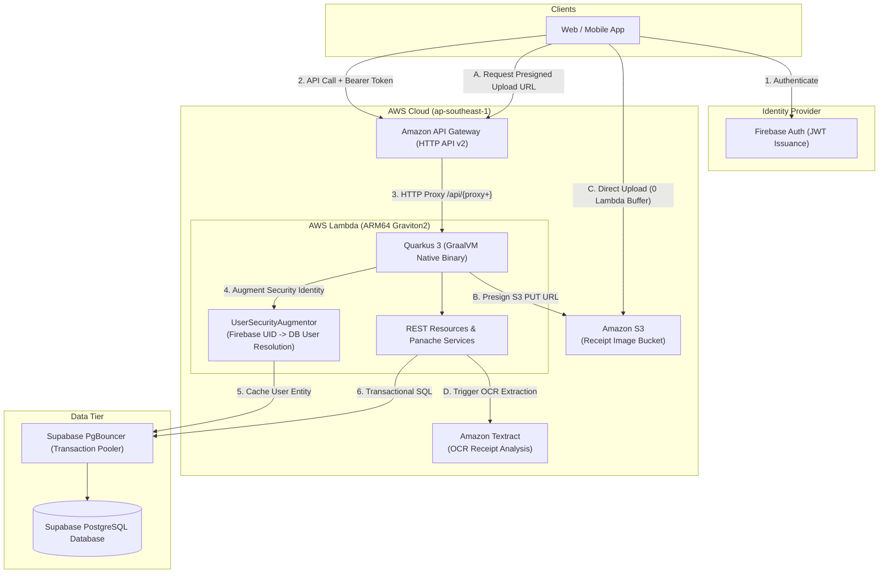

# Warranty Tracker API

[](https://github.com/649000/warranty-tracker-api/actions/workflows/ci.yml)
[](https://github.com/649000/warranty-tracker-api/actions/workflows/codeql.yml)
[](api/pom.xml)
[](https://openjdk.org/)
[](https://quarkus.io/)
[](https://www.graalvm.org/)
[](https://aws.amazon.com/lambda/)
[](https://supabase.com/)
[](LICENSE)

A cloud-native, serverless REST API for managing product warranties, claims, and purchase receipts. Designed for high performance and minimal idle cost, running on **AWS Lambda ARM64 (Graviton2)** compiled with **Quarkus 3 and GraalVM Native Image**.

---

## Cloud & Serverless Runtime Architecture



---

## Why Serverless?

Serverless compute fits this workload with minimal baseline traffic. AWS Lambda's pay-per-request pricing provides zero cost when idle. Paired with GraalVM native binaries running on ARM64 Graviton2, cold start overhead is virtually eliminated while maximizing performance per dollar.

## Tech Stack

- **Framework**: Quarkus 3.28 with SmallRye OpenAPI and Panache ORM
- **Runtime & Language**: Java 21, GraalVM Native Image (ARM64 Linux container build)
- **Compute**: AWS Lambda (Custom Runtime `provided.al2023`, Graviton2)
- **API Routing**: Amazon API Gateway (HTTP API v2)
- **Database**: Supabase PostgreSQL with built-in PgBouncer connection pooling
- **Authentication**: Firebase Authentication (Google JWK public key validation)
- **Storage**: Amazon S3 (Direct presigned URL uploads)
- **Document OCR**: Amazon Textract for receipt information extraction
- **Infrastructure as Code (IaC)**: AWS CDK v2 in Java (APIGatewayStack & APIStack)
- **Testing & Quality**: JUnit 5, Mockito, AssertJ, and JaCoCo (enforced 95% threshold)

---

## Key Architectural Decisions

* **Supabase with Built-in PgBouncer over AWS RDS:** Serverless Lambdas create bursty, short-lived connections that can quickly exhaust relational databases. Supabase provides an integrated PgBouncer transaction connection pooler out of the box, avoiding the operational cost and complexity of AWS RDS Proxy.
* **Presigned S3 Direct Uploads:** Mobile and web clients upload receipt images directly to S3 via temporary presigned URLs. Lambda only signs the request and never buffers file bytes in memory, keeping execution times under 20ms and bypassing API Gateway payload size limits.
* **Request-Scoped Security Augmentation (`UserSecurityAugmentor`):** Custom Quarkus `SecurityIdentityAugmentor` validates Firebase JWT claims, queries the PostgreSQL `User` record once per request, and stores it in the `SecurityIdentity` context. Panache resources retrieve the validated user in-memory with zero redundant DB queries.
* **Native ARM64 Graviton2 Compilation:** Ahead-of-Time (AOT) compilation with GraalVM produces a self-contained ~35MB native executable. Cold starts drop to under 800ms (compared to 6-9 seconds on standard JVM) with a 70% reduction in memory footprint.
* **JSON:API Standard Error Formatting:** All exception mappers translate domain errors, validation failures, and unhandled exceptions into structured JSON:API error payloads (`title`, `code`, `status`, `detail`).

---

## Core API Endpoints

The API is mounted at root path `/api`. Interactive Swagger documentation is available in dev mode at `/api/q/swagger-ui`.

| Domain | Method | Endpoint | Description | Auth Required |
| :--- | :--- | :--- | :--- | :---: |
| **System** | `GET` | `/q/health` | Health check endpoint | No |
| **System** | `GET` | `/api/q/openapi` | OpenAPI v3 specification | No |
| **User** | `GET` | `/api/user` | Fetch authenticated user profile | Yes |
| **User** | `PUT` | `/api/user` | Update display name / profile | Yes |
| **Companies** | `GET` | `/api/company` | List warranty provider companies | Yes |
| **Companies** | `GET` | `/api/company/{id}` | Get company contact & claim instructions | Yes |
| **Products** | `GET` | `/api/products` | Browse product catalog | Yes |
| **User Products**| `GET` | `/api/user-products` | List user's registered products | Yes |
| **User Products**| `POST`| `/api/user-products` | Register newly purchased product | Yes |
| **Warranties** | `GET` | `/api/warranties` | List active & expired warranties | Yes |
| **Warranties** | `POST`| `/api/warranties` | Create warranty record linked to product | Yes |
| **Claims** | `GET` | `/api/claims` | View status of submitted warranty claims | Yes |
| **Claims** | `POST`| `/api/claims` | File a new claim with reference number | Yes |
| **Storage (S3)**| `GET` | `/api/s3/presigned-url` | Generate presigned PUT URL for receipt image | Yes |
| **Receipts** | `POST`| `/api/receipts` | Trigger Textract OCR extraction on receipt | Yes |

---

## Local Development & Build

### Running in Dev Mode

```bash
# Set database credentials
export SUPABASE_DB_URL="jdbc:postgresql://..."
export SUPABASE_DB_USER="..."
export SUPABASE_DB_PASSWORD="..."

# Start Quarkus Live Reload
./mvnw quarkus:dev
```

* Dev UI: `http://localhost:8080/q/dev`
* Swagger UI: `http://localhost:8080/api/q/swagger-ui`
* Health check: `http://localhost:8080/q/health`

### Testing & Code Coverage

```bash
# Run all 313 unit tests and verify 95% JaCoCo coverage threshold
mvn test -pl api

# Run CDK infrastructure stack tests
mvn test -pl cdk
```

### Packaging & Deployment

```bash
# Development (JVM Lambda bundle)
mvn clean package -pl api
cd cdk && cdk deploy --all

# Production (GraalVM Native ARM64 bundle)
mvn clean package -Dnative -Dquarkus.native.container-build=true -pl api
cd cdk && cdk deploy -c env=prd --all
```

---

## CI/CD & DevSecOps Architecture

The repository enforces automated quality gates and security checks on every push and pull request via **GitHub Actions**:

```
Git Push / PR ──► Gitleaks (Secrets) ──► Maven Test (Java 21) ──► CodeQL (SAST) ──► CDK Synth (IaC)
                                                                                          │
                                                              Merge to main               ▼
Prod Native Lambda ◄── Approval Gate ◄── DAST (OWASP ZAP) ◄── CDK Deploy Dev (JVM) ◄──────┘
```

1. **Continuous Integration (`ci.yml`)**:
   - **Gitleaks**: Scans commit history for credential leaks.
   - **Java 21 Build & JaCoCo Gate**: Executes 313 unit tests and enforces a **95% code coverage threshold**.
   - **Infrastructure Validation**: Runs CDK unit tests and synthesizes CloudFormation templates for both `dev` and `prd`.
   - **Dependency Review (SCA)**: Blocks PRs introducing vulnerable dependencies.
2. **Static Application Security Testing (`codeql.yml`)**:
   - Performs semantic AST and dataflow scanning for security flaws, publishing results to GitHub Security tab.
3. **Dynamic Application Security Testing (`dast.yml`)**:
   - OWASP ZAP dynamic API scanner executed against the OpenAPI schema to identify runtime security header and injection vulnerabilities.
4. **Continuous Delivery (`cd.yml`)**:
   - Keyless deployment to AWS via AWS IAM OpenID Connect (OIDC) with GitHub Actions environment protection.
5. **Dependabot (`dependabot.yml`)**:
   - Weekly automated security updates for Maven dependencies and GitHub Actions.

---

## Setting up AWS OIDC for Deployments

To deploy without long-lived AWS keys, configure IAM OpenID Connect:

1. **Add GitHub OIDC Provider in AWS IAM**:
   - Provider URL: `https://token.actions.githubusercontent.com`
   - Audience: `sts.amazonaws.com`
2. **Create IAM Role with Trust Policy**:
   ```json
   {
     "Version": "2012-10-17",
     "Statement": [
       {
         "Effect": "Allow",
         "Principal": {
           "Federated": "arn:aws:iam::<ACCOUNT_ID>:oidc-provider/token.actions.githubusercontent.com"
         },
         "Action": "sts:AssumeRoleWithWebIdentity",
         "Condition": {
           "StringEquals": {
             "token.actions.githubusercontent.com:aud": "sts.amazonaws.com"
           },
           "StringLike": {
             "token.actions.githubusercontent.com:sub": "repo:<GITHUB_OWNER>/<REPO>:*"
           }
         }
       }
     ]
   }
   ```
3. **Set GitHub Repository Secrets** (`Settings > Secrets and variables > Actions`):
   - `AWS_ROLE_ARN`: `arn:aws:iam::<ACCOUNT_ID>:role/<ROLE_NAME>`
   - `SUPABASE_DB_URL`, `SUPABASE_DB_USER`, `SUPABASE_DB_PASSWORD`

---

## Future Roadmap

- [ ] **AWS X-Ray Distributed Tracing** - End-to-end tracing across API Gateway, Lambda, and Supabase.
- [ ] **Structured JSON Logging** - Correlated logs for CloudWatch Logs Insights queries.
- [ ] **Async OCR via Amazon SQS** - Offload Textract processing to an asynchronous queue for instant API acknowledgments.
- [ ] **Warranty Expiry Alerts** - Amazon SNS / SES notifications when registered warranties approach expiration.
- [ ] **Flyway Migrations** - Version-controlled schema evolutions.

---

## License

This project is open-source under the [MIT License](LICENSE).
